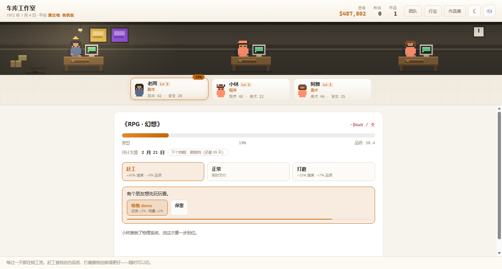
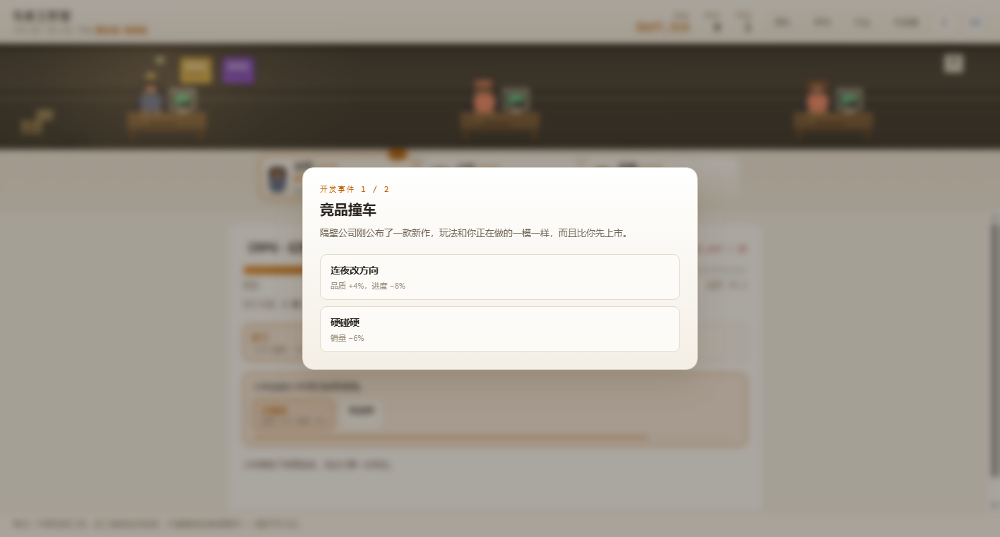
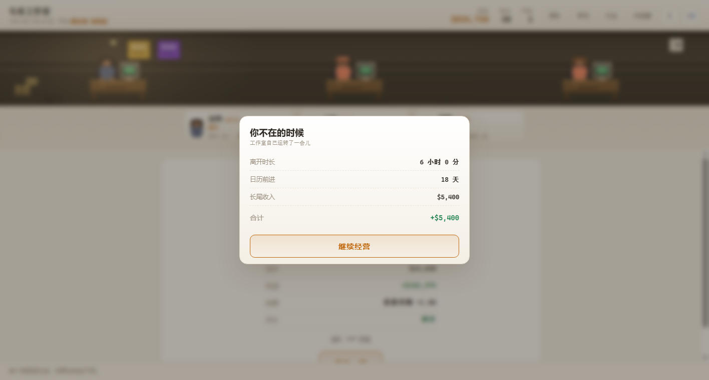

# 游戏工坊物语 · Game Workshop Story

> 像素游戏工作室经营模拟。1972 年从一间车库起步，30 年做到独栋总部——挑企划、盯开发、等评审打分、看它卖多少。
>
> 纯静态、零依赖、零构建，双击 `index.html` 就能玩。右上角 ⚙ 是设置（音量、存档、规则说明）。

**在线玩**：https://magatamastudio.github.io/game-workshop-story/
**完整设计**：[docs/DESIGN-GDS.md](docs/DESIGN-GDS.md)

## 跑起来

```bash
node tools/serve.js
# 打开 http://127.0.0.1:8765
```

双击 `index.html` 也能跑（`file://` 下同样工作）。

## 一局是什么

```
企划  选类型 × 题材 × 规模 × 主创 × 平台（可以选续作 / 联合开发）
 ↓
开发  ~42 秒：按天烧工资，随时切「赶工 / 正常 / 打磨」，中途 2 次事件 + 3 次小决定
 ↓
评审  四位评论家逐个亮分，总分 40
 ↓
发售  立即发售，或压货等档期（暑期 ×1.25 / 年末 ×1.40）
 ↓
销售  20 周，每周结算；下方针下直接点宣发
 ↓
结算  分数、销量、成本、利润
```

一局约 90 秒。分数低会亏钱，分数高能回本 3–5 倍。

11 个平台在这 30 年里依次上市、走红、退市。2002 年结算结局，之后进入无尽模式。

| 企划 | 开发 | 事件 | 评审 | 发售 |
|---|---|---|---|---|
|  |  |  |  |  |

## 内容一览

| 项 | 数量 |
|---|---|
| 类型 × 题材 | 10 × 10 = **100 格相性**，其中 12 格「王牌组合」（≥1.30） |
| 平台 | 25 个（1972–2002 有 11 个，之后 14 个无尽平台），会退市 |
| 员工 | 30 人池，开局 3 人，办公室 6 级最多 8 个工位 |
| 开发事件 | 30 个（早期 / 后期两池） |
| 小决定 | 8 种，每部作品出 3 次，限时选择 |
| 研究 | 48 项，分技术 / 内容 / 商业 / 团队四支线，按年份开放 |
| 设备 | 48 件，买断制立刻生效，**13 件会画进像素办公室** |
| 员工特质 | 20 个，由 seed 确定性派生 |
| 对手 | 6 家 AI 工作室，每年出片，会抢档期、抢奖、挖人 |
| 奖项 | 6 类（年度游戏 + RPG / 动作 + 画面 / 音乐 / 剧情），一年最多 6 座 |
| 办公室 | 6 级：车库 → 街边二层 → 写字楼整层 → 独栋小楼 → 创意园区 → 总部大楼 |
| 创业宣言 | 4 种（破产重开另有 4 种） |
| 宣发动作 | 6 种，各有次数上限 |

## 核心机制

**相性与组合收藏**：类型 × 题材决定品质系数（0.75–1.35）。100 格分三档解锁——开局每个类型只开相性最高的 2 个题材，其余靠做作品（每部 +2）、做研究（每项 +1）、收购对手慢慢集齐。相性 ≥1.30 的 12 格是王牌组合，做出来一次就加星。

**规模**：小型 / 中型 / 大型。三档的「销量 ÷ 成本」回报率刻意拉平（0.97 / 1.00 / 0.94），差异在别处——小型开发快（同样时间塞更多部），大型品质高（更容易冲高分）。选规模不是选「哪个更赚」，是选「这一部冲速度还是冲质量」。

**团队**：人多开发更快（每多一人 −4 秒）、品质更高（每多一人 +4%），但日薪也更高。每人有士气与体力——连着赶工会掉体力（<35 慢 12%，<15 慢 30%），作品扑街掉士气（<30 品质 −6%）。可以花钱团建救一次，也可以给单个人开小灶培训（主属性 +2、次属性 +1，每人每部一次）。

**续作**：卖过 8 万份的作品能出续作，销量 ×1.25、耗时 ×0.88、相性 ×0.85，编号一路接下去。

**市场流行与怀旧**：每年 2 个题材 + 1 个类型走红（销量 ×1.25 / ×1.10）；每 12 年一次怀旧潮，某个老类型销量 ×1.30。

**宣发（销售期）**：20 周销售期，曲线前重后轻（前 4 周占 79%），所以越早投越值。6 个动作直接铺在销售页底部：

| 动作 | 效果 | 次数 |
|---|---|---|
| 主播试玩 | 余下每周 ×1.16 | 1 |
| 论坛投放 | 余下每周 ×1.06 | 3 |
| 社区赛事 | ×1.20 + 粉丝 +3000 | 1 |
| 实体加印 | ×1.12 | 1 |
| 口碑补丁 | ×1.05 + 声望 +2 | 2 |
| 限时降价 | ×1.15 但单价 ×0.88 | 1 |

叠加后的倍率封顶 ×1.35，所以是「什么时候花」的取舍，不是点满就行。

**平台不是背景板**：L-3 在 1983 年上市时装机涨到 4.0，1992 年只剩 0.3。一直做老平台，销量会慢慢枯竭；太早跳新平台，装机还没铺开。平台会老死（提前 2 年预警），退市后不能立项、长尾只剩 8%——但旧作可以**移植**到新平台复活。

**自研平台**：2068 年起可以自己当平台方（研发投入 / 售价 / 抽成三档），收第三方抽成。但每年要付维护费，连亏 2 年会倒闭、赔掉 60% 现金。

**2075 之后：自定时代**：每 8 年用「影响力」选一张时代规则卡（也能重抽或随机），影响速度 / 品质 / 工资 / 销量 / 长尾 / 抽成，10% 概率出范式跃迁（两条规则叠加）。

**收购与合作**：可以挖对手的人、收购整家（停止参赛 + 粉丝 + 月度分成）、把作品变子品牌；破产时脱离的子公司之后能按 0.8 折买回。企划里还能拉一家对手**联合开发**——成本 −40%、品质与销量加成，代价是分走 15% 收入。

**存档**：浏览器本地自动保存，另有 6 个手动存档槽（保存 / 改名 / 读取 / 删除），支持导出文本分享、粘贴导入。设置页还能导出当前进度、清空重开。

## 结算与长尾

发出去的每部作品每月继续带来 **0.6%** 长尾收入（平台退市后只剩 8%），这是无尽模式的现金流。

**离线**只算钱、不算进度——开发停在原地等你回来，在售作品会自己卖完。

2002 年结局按作品与奖项判定：**时代定义者 / 一流工作室 / 小而美 / 勉强维生**。之后可以**继续经营**（无尽），或**带收藏开第二轮（NG+）**——收藏、子品牌、10% 粉丝都带走，日历 ×2，每部多解锁 1 格组合。

| 团队 | 作品集 | 行业 |
|---|---|---|
|  |  |  |

| 研发与设备 | 离线报告 | 结局 |
|---|---|---|
|  |  |  |

## 开发

```bash
node tools/serve.js        # 本地服务（127.0.0.1:8765）
node tools/test.js         # 637 项引擎逻辑测试（纯 Node，不需要浏览器）
node tools/e2e.js <url>    # 213 项浏览器端测试（需要本机 Edge）
node tools/balance.js 4    # 30 年主线数值模拟（可加 detail / compare）
node tools/shots.js <url>  # 生成截图
```

```
index.html
css/style.css
js/config.js     数据表：类型/题材/规模/员工/研究/设备/平台/事件/数值
js/engine.js     纯逻辑状态机，可在 Node 里直接跑
js/audio.js      WebAudio 合成器（音效 + 程序化 BGM）
js/office.js     像素办公室画布
js/ui.js         界面、面板与像素小人
js/main.js       启动、主循环、存档与离线结算
tools/           本地服务、测试、模拟器、截图
docs/            设计文档与截图
```

引擎与界面完全分离：`engine.js` 不碰 DOM，所以能在 Node 里跑完整 30 年模拟（`balance.js` 就是这么做平衡验证的）。

## 分支

| 分支 | 内容 |
|---|---|
| `v2` | **默认分支**，当前版本 |
| `v1-idle` | 旧的增量放置版，仍然在线可玩 |
