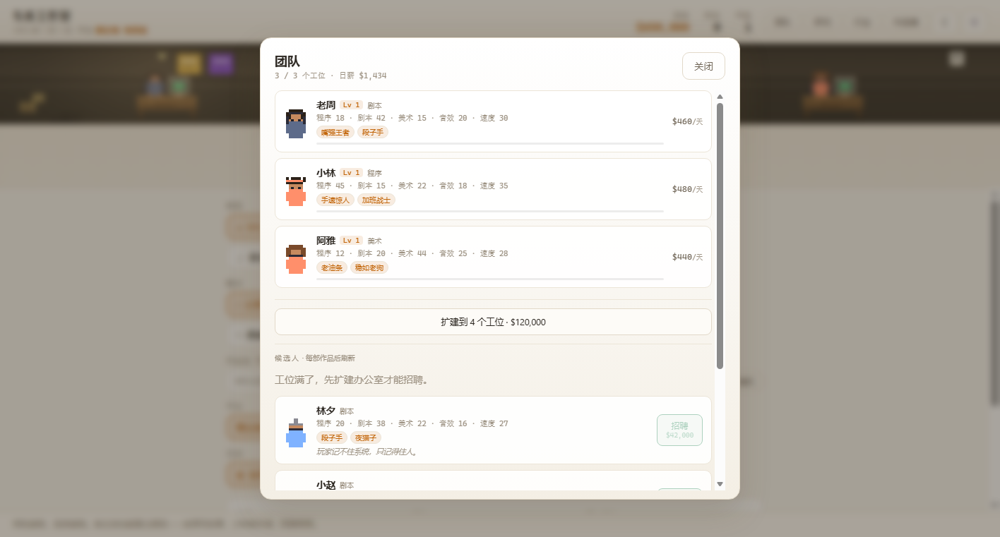
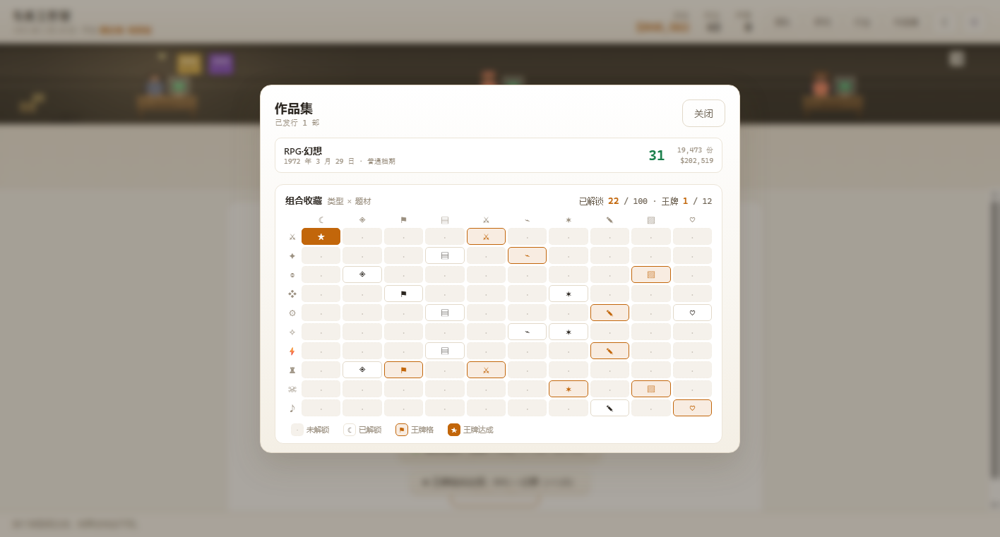

# 车库工作室 · M0

> 《游戏发展国》式经营模拟的**垂直切片**：一家 1983 年的小工作室，做一部游戏，等评审打分，看它卖多少。
>
> 纯静态、零依赖，双击 `index.html` 就能玩。默认浅色主题，右上角可以切深色。
>
> 完整设计见 [docs/DESIGN-GDS.md](docs/DESIGN-GDS.md)。

## 跑起来

```bash
node tools/serve.js
# 打开 http://127.0.0.1:8765
```

纯静态、零依赖、零构建，双击 `index.html` 也能跑。

## 一局是什么

```
企划（选类型 × 题材 × 主创 × 平台）
  → 开发 42 秒：按天烧工资，随时切「赶工 / 正常 / 打磨」，中间有 2 次事件 + 3 次小决定
  → 评审：四位评论家逐个亮分，总分 40
  → 发售决策：立即发售，还是压货等档期（暑期 ×1.25 / 年末 ×1.40）
  → 销售：12 周，每周结算一次，可追加一次广告
  → 结算：分数、销量、成本、利润
```

一局约 90 秒。分数低会亏钱，分数高能回本 3–5 倍。

一局 = 30 年。1972 年从一台街机基板起步，11 个平台依次上市、走红、退市。2002 年结算结局——之后再玩就是无尽模式。

| 企划 | 开发 | 事件 | 评审 | 发售 |
|---|---|---|---|---|
|  |  |  |  |  |

## M0 有什么

- 5 类型 × 5 题材（25 格相性）、3 名员工（老周/小林/阿雅）、4 位评委
- 11 个开发事件（分早期/后期两池）+ 8 个可选小决定
- 档期：暑期 ×1.25 / 年末 ×1.40，可压货等档期
- 团队：从 3 人到 6 人，招聘、签约金、日薪、每局经验与升级
- 平台时间线：1972–2002 的 11 个平台，加上 2002 之后的 14 个无尽平台
- 竞争对手：6 家 AI 工作室每年出片，年度奖项是「和他们比」
- 抢档期：和对手撞在同一两周，销量会互相压
- 平台用恶搞厂商名：雅达瑞 / 天任 / 世加 / 索妮 / 微硬 / 平果
- 年度奖项：每年评一次，年度游戏 / 年度提名
- 结局：30 年结束按作品与奖项判定四种结局
- 存档：自动保存在浏览器本地，关掉再打开接着玩
- 作品集：每一部作品的分数、销量、档期都记着
- 长尾：发出去的每部作品每月继续带来 0.6% 收入
- 离线：关掉页面再回来，会结算在售销量与长尾（最多 8 小时）
- 追加广告、资金不足时找发行商预支
- WebAudio 合成的 8-bit 音效（点击、亮分、总分、周结算），可静音
- 程序化生成的像素小人
- 20 个员工特质、24 项研究、24 件设备、4 条创业宣言
- 组合收藏：100 格类型×题材分批解锁，12 格王牌组合

## 研发与设备

|  |  |
|---|---|

24 项研究分技术 / 内容 / 商业 / 团队四条支线，按游戏内日历推进、一次只能做一个；24 件设备买断制、立刻生效，**其中 8 件会真的画进像素办公室**——地毯铺在桌子下面，街机柜和服务器摆在桌子前面的空地上，霓虹灯牌挂墙上。

每个人还有 2 个特质（夜猫子 / 完美主义 / 混子…），由 seed 确定性派生，团队面板里能看到。

## 行业与竞争对手


六家 AI 工作室各有风格和出道年份，每年都会发一部作品。年度奖项不是跟自己比分数，是**跟当年所有作品比**——输了会看到他们把奖杯拿走。

## 30 年时间线


平台不是背景板：L-3 在 1983 年上市时装机一路涨到 4.0，1992 年就剩 0.3。一直做老平台，销量会慢慢枯竭；太早跳到新平台，装机还没铺开。

每年年底评奖，2002 年给出结局——**时代定义者 / 一流工作室 / 小而美 / 勉强维生**。

## 团队与作品集

| 团队面板 | 作品集 |
|---|---|
|  |  |

人多开发更快（每多一人 −4 秒）、品质更高（每多一人 +4%），但日薪也更高。招之前先算一下：这个人值不值他的工资。

作品集底部是**组合收藏**：类型 × 题材一共 100 格，开局每个类型只开相性最高的 2 个题材，其余靠做作品（每部 +2）、做研究（每项 +1）、收购对手（解锁它主打的组合）慢慢集齐。相性 ≥1.30 的 12 格是**王牌组合**，做出来一次就在收藏里加星。

## 离线结算


离线只算钱，不算进度——开发停在原地等你回来。在售的作品会自己卖完，所有作品按每月 0.6% 给长尾。作品越多，回来那一笔越厚。

## M0 故意不做什么

存档、离线收益、招聘与培训、办公室升级、竞争对手、平台换代、奖项。

这些都排在 M1 之后，见设计文档第 11 章。

## 开发

```bash
node tools/test.js     # 54 项引擎逻辑测试
node tools/e2e.js      # 31 项浏览器端测试（需要本机 Edge + 服务器已启动）
node tools/shots.js    # 生成截图
```

```
index.html
css/style.css
js/config.js     数据表：类型/题材/员工/评审/事件/数值
js/engine.js     纯逻辑状态机，可在 Node 里跑
js/audio.js      WebAudio 合成器
js/ui.js         界面与像素小人
js/main.js       启动与主循环
tools/           本地服务、测试、截图
```

## 分支说明

| 分支 | 内容 |
|---|---|
| `v2` | 当前，M0 重写 |
| `v1-idle` | 旧的增量放置版，仍然在线可玩 |

v2 通过 M0 验收后才会转正为 `main`。
