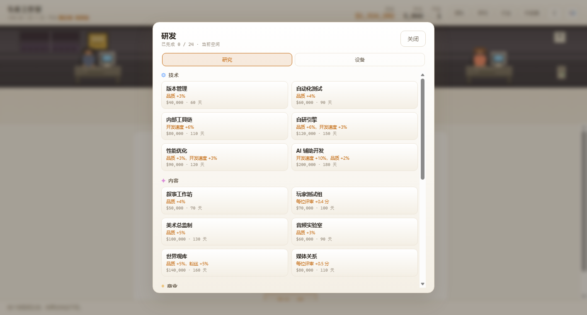
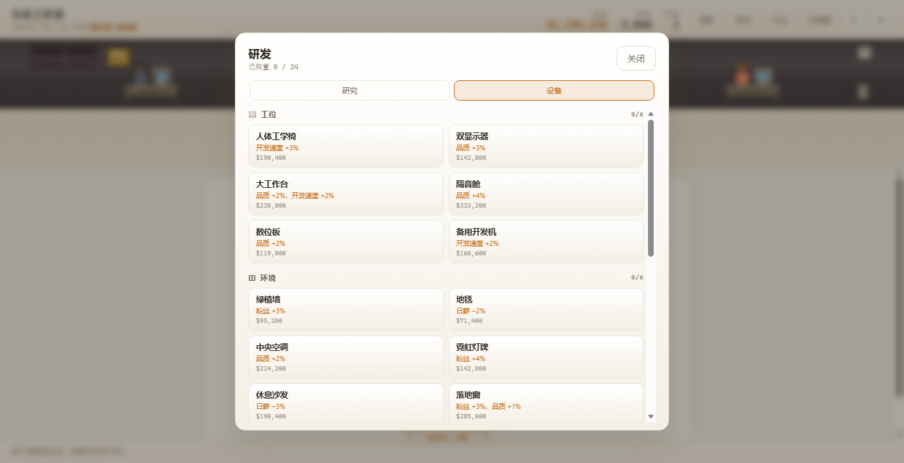
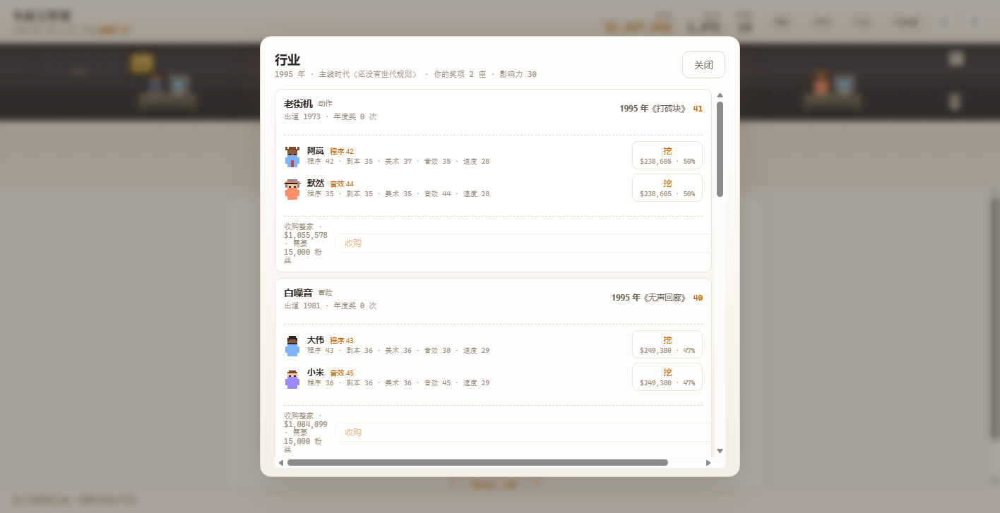
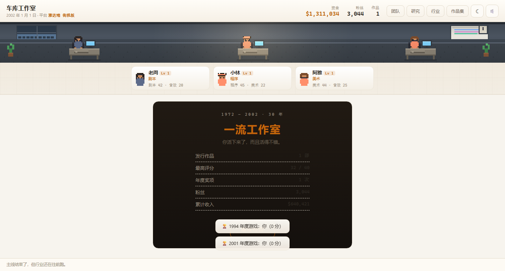

# 车库工作室 · M0

> 《游戏发展国》式经营模拟的**垂直切片**：一家 1983 年的小工作室，做一部游戏，等评审打分，看它卖多少。
>
> 纯静态、零依赖，双击 `index.html` 就能玩。默认浅色主题，右上角可以切深色。
>
> 完整设计见 [docs/DESIGN-GDS.md](docs/DESIGN-GDS.md)。

## 跑起来

```bash
node tools/serve.js
# 打开 http://127.0.0.1:8765
```

纯静态、零依赖、零构建，双击 `index.html` 也能跑。

## 一局是什么

```
企划（选类型 × 题材 × 主创 × 平台）
  → 开发 42 秒：按天烧工资，随时切「赶工 / 正常 / 打磨」，中间有 2 次事件 + 3 次小决定
  → 评审：四位评论家逐个亮分，总分 40
  → 发售决策：立即发售，还是压货等档期（暑期 ×1.25 / 年末 ×1.40）
  → 销售：12 周，每周结算一次，可追加一次广告
  → 结算：分数、销量、成本、利润
```

一局约 90 秒。分数低会亏钱，分数高能回本 3–5 倍。

一局 = 30 年。1972 年从一台街机基板起步，11 个平台依次上市、走红、退市。2002 年结算结局——之后再玩就是无尽模式。

| 企划 | 开发 | 事件 | 评审 | 发售 |
|---|---|---|---|---|
|  |  |  |  |  |

## M0 有什么

- 5 类型 × 5 题材（25 格相性）、3 名员工（老周/小林/阿雅）、4 位评委
- 11 个开发事件（分早期/后期两池）+ 8 个可选小决定
- 档期：暑期 ×1.25 / 年末 ×1.40，可压货等档期
- 团队：从 3 人到 6 人，招聘、签约金、日薪、每局经验与升级
- 平台时间线：1972–2002 的 11 个平台，加上 2002 之后的 14 个无尽平台
- 竞争对手：6 家 AI 工作室每年出片，年度奖项是「和他们比」
- 抢档期：和对手撞在同一两周，销量会互相压
- 平台用恶搞厂商名：雅达瑞 / 天任 / 世加 / 索妮 / 微硬 / 平果
- 年度奖项：6 类同台评（年度游戏 + 最佳 RPG/动作 + 最佳画面/音乐/剧情），一年最多拿 6 座
- 结局：30 年结束按作品与奖项判定四种结局
- 存档：自动保存在浏览器本地，关掉再打开接着玩
- 作品集：每一部作品的分数、销量、档期都记着
- 长尾：发出去的每部作品每月继续带来 0.6% 收入
- 离线：关掉页面再回来，会结算在售销量与长尾（最多 8 小时）
- 追加广告、资金不足时找发行商预支
- WebAudio 合成的 8-bit 音效（点击、亮分、总分、周结算），可静音
- 程序化生成的像素小人
- 20 个员工特质、48 项研究、48 件设备（后一半按年份开放）、4 条创业宣言
- 组合收藏：100 格类型×题材分批解锁，12 格王牌组合
- 续作：销量 ≥8 万的旧作能出续作（销量 ×1.4 / 耗时 ×0.8 / 相性 ×0.85），系列编号一路接下去
- 办公室 4 级：车库 → 街边二层 → 写字楼整层 → 独栋小楼，搬一次换一次房间和画面
- 市场流行：每年 2 个题材 + 1 个类型走红，命中销量 ×1.25 / ×1.10
- 平衡：加成有收益递减、平台上限随年代放宽，后期不会每部都满分
- 平台退市：平台会老死（提前 2 年预警），退市后不能立项、长尾只剩 8%
- 移植：旧作可搬到新平台复活（成本 25%、销量 = 原销量 × 装机比 × 45%）
- 自定时代：2075 之后每 8 年自己定一条新规则（用影响力选卡 / 重抽 / 随机，10% 概率范式跃迁）
- 士气与体力：每部作品涨落，低了掉速度/掉品质，可以花钱包一次团建救回来
- 怀旧潮：每 12 年一次、持续 2 年，某个老类型销量 ×1.30
- NG+：结局后带收藏 / 子品牌 / 10% 粉丝回到 1972，日历 ×2，每部多解锁 1 格组合

## 研发与设备

|  |  |
|---|---|

48 项研究分技术 / 内容 / 商业 / 团队四条支线（后 24 项按年份开放），按游戏内日历推进、一次只能做一个；48 件设备买断制、立刻生效（后一半按年份开放），**其中 13 件会真的画进像素办公室**——地毯铺在桌子下面，街机柜和服务器摆在桌子前面的空地上，霓虹灯牌挂墙上。

每个人还有 2 个特质（夜猫子 / 完美主义 / 混子…），由 seed 确定性派生，团队面板里能看到。

## 行业与竞争对手



六家 AI 工作室各有风格和出道年份，每年都会发一部作品。年度奖项不是跟自己比分数，是**跟当年所有作品比**——输了会看到他们把奖杯拿走。奖项分 6 类：年度游戏和类型奖比总分，最佳画面 / 音乐 / 剧情比单项分，所以「有个好美术」的偏科工作室也能靠单项奖拿声望。

## 30 年时间线



平台不是背景板：L-3 在 1983 年上市时装机一路涨到 4.0，1992 年就剩 0.3。一直做老平台，销量会慢慢枯竭；太早跳到新平台，装机还没铺开。

每年年底评奖，2002 年给出结局——**时代定义者 / 一流工作室 / 小而美 / 勉强维生**。

## 团队与作品集

| 团队面板 | 作品集 |
|---|---|
|  |  |

人多开发更快（每多一人 −4 秒）、品质更高（每多一人 +4%），但日薪也更高。招之前先算一下：这个人值不值他的工资。

团队面板顶部是你现在待的地方：**车库 → 街边二层 → 写字楼整层 → 独栋小楼**。买工位就是搬办公室（研发 → 设备页最上面也能直接买），每搬一次房间、地面、窗户都会变，还给品质/研究/销量加成。员工可以解雇，付 30 天日薪作为遣散费，人会回到候选池、之后还能再招回来。

作品集底部是**组合收藏**：类型 × 题材一共 100 格，开局每个类型只开相性最高的 2 个题材，其余靠做作品（每部 +2）、做研究（每项 +1）、收购对手（解锁它主打的组合）慢慢集齐。相性 ≥1.30 的 12 格是**王牌组合**，做出来一次就在收藏里加星。

某部作品卖过 8 万份之后，企划界面上会多一个「续作」组——可以直接接着做，销量 +40%、开发时间 −20%，但相性打 0.85 折。续作还能再出续作，编号会一路接下去（「古墓丽影 2」「古墓丽影 3」，不会变成「古墓丽影2 3」）。

每年还会滚一次**市场流行**：2 个题材 + 1 个类型走红，命中的销量分别是 ×1.25 / ×1.10。企划顶部会告诉你今年什么好卖，chip 上有「热」标——不追也能赢，追了更省力。

团队面板里每人有**士气**和**体力**两条。连着赶工会掉体力（<35 慢 12%，<15 慢 30%），作品扑街会掉士气（<30 品质 −6%）。每部作品之间会回一点，也可以花钱包一次**团建**（每部一次，士气 +15 / 体力 +10）。

每 12 年还有一次**怀旧潮**：某个老类型突然又流行，整年销量 ×1.30（企划顶部有提示）。

2002 年主线结束后有两个选择：**继续经营**（无尽模式），或者**带收藏开第二轮（NG+）**——组合收藏、子品牌、10% 粉丝都带走，日历 ×2，每部作品多解锁 1 格组合，目标变成集齐 100 格图鉴。

## 离线结算


离线只算钱，不算进度——开发停在原地等你回来。在售的作品会自己卖完，所有作品按每月 0.6% 给长尾。作品越多，回来那一笔越厚。

## M0 故意不做什么

存档、离线收益、招聘与培训、办公室升级、竞争对手、平台换代、奖项。

这些都排在 M1 之后，见设计文档第 11 章。

## 开发

```bash
node tools/test.js     # 54 项引擎逻辑测试
node tools/e2e.js      # 31 项浏览器端测试（需要本机 Edge + 服务器已启动）
node tools/shots.js    # 生成截图
```

```
index.html
css/style.css
js/config.js     数据表：类型/题材/员工/评审/事件/数值
js/engine.js     纯逻辑状态机，可在 Node 里跑
js/audio.js      WebAudio 合成器
js/ui.js         界面与像素小人
js/main.js       启动与主循环
tools/           本地服务、测试、截图
```

## 分支说明

| 分支 | 内容 |
|---|---|
| `v2` | 当前，M0 重写 |
| `v1-idle` | 旧的增量放置版，仍然在线可玩 |

v2 通过 M0 验收后才会转正为 `main`。
