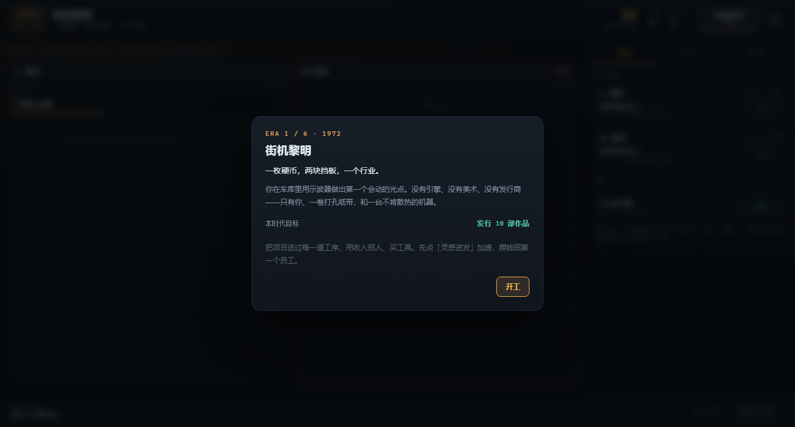
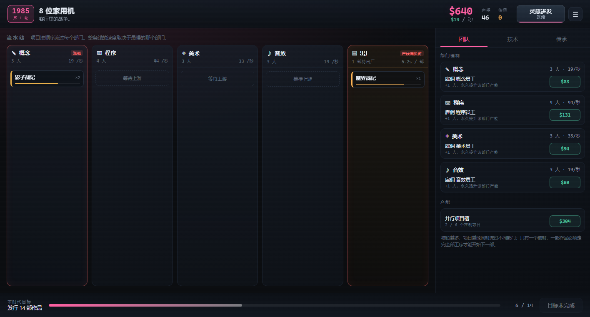
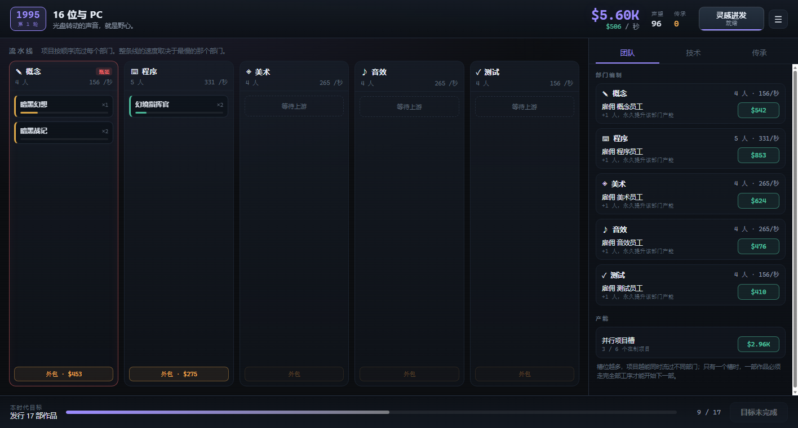

# 游戏开发流水线 · Game Dev Pipeline Idle

> 从 1972 年的车库到服务型时代，经营一家穿越整个游戏史的工作室。
> 纯静态网页增量放置游戏，无需后端，可直接托管在 GitHub Pages。

**玩法一句话**：项目按「概念 → 程序 → 美术 → 音效 → 打磨」流过流水线，整条线的速度由最慢的部门决定。招人补瓶颈、买工具提产能，用发行收入进入下一个时代。

---

## 马上试玩

```bash
# 方式一：直接双击 index.html（无构建、无依赖）
# 方式二：起一个本地服务器（推荐，localStorage 更稳定）
node tools/serve.js
# 打开 http://127.0.0.1:8765
```

## 三分钟上手

1. 点右上角 **灵感迸发**，全部门产能 ×2.5，撑过开局。
2. 第一部作品发行后会拿到钱。左侧 **团队** 页签招人——**看清楚哪个部门标着「瓶颈」**，钱花在那里收益最大。
3. **技术** 页签买工具（只加单个部门）和引擎（加所有部门）。**并行项目槽** 让多部作品同时流过不同工序。
4. 1985 年会多出一列 **出厂**：卡带要排队压片，开发再快也得等产线，产线可以在技术页升级。1995 年每个部门下方有 **外包** 按钮，卡住时花钱一键清空积压。
5. 底部进度满了就能进入下一个时代。
6. 每次换代团队和资金清零，但会留下**传承点**，在 **传承** 页签买永久加成。走完第六个时代后会带着全部传承回到 1972，开始第二轮。

关闭页面也会按 50% 效率结算离线收益（最多 8 小时），「远程办公」传承可以把这个效率提上去。

## 截图

| 1972 · 开局 | 1985 · 卡带产线 |
|---|---|
|  |  |

| 1995 · 外包 |
|---|
|  |

## 六个时代

| # | 年份 | 时代 | 新部门 | 时代专属机制 |
|---|------|------|--------|--------------|
| 1 | 1972 | 街机黎明 | 概念、程序 | — 先把基本循环跑通 |
| 2 | 1985 | 8 位家用机 | +美术、音效 | **卡带产线**：做完的卡带还要排队压片，出厂速度是硬瓶颈，可以花钱扩产线 |
| 3 | 1995 | 16 位与 PC | +测试 | **外包**：花钱瞬间清空某个部门的积压，代价是这部作品约 55% 的收入 |
| 4 | 2005 | 3D 与在线 | — | 硬件膨胀、联网 |
| 5 | 2013 | 移动与独立 | 测试 → 运营 | 渠道与变现变了 |
| 6 | 2022 | 服务型时代 | 运营 → 长线运营 | 上线只是开始 |

## 项目结构

```
index.html            页面骨架
css/style.css         全部样式（含六套时代配色）
js/config.js          所有数值、文案、时代表 —— 调平衡只改这里
js/engine.js          纯逻辑，不碰 DOM，可在 Node 里跑
js/ui.js              渲染与交互
js/main.js            启动、主循环、存档、离线结算
tools/serve.js        本地静态服务器
tools/test.js         引擎逻辑测试（43 项）
tools/sim.js          数值模拟器（AI 跑完整轮，输出每时代耗时）
tools/e2e.js          CDP 驱动的浏览器冒烟测试
tools/shots.js        生成展示截图
docs/DESIGN.md        完整设计文档
```

## 开发

```bash
node tools/serve.js        # 本地预览
node tools/test.js         # 引擎逻辑测试
node tools/sim.js          # 跑数值模拟：每个时代耗时、传承收益
node tools/e2e.js          # 浏览器端冒烟测试（需要本机 Edge + 服务器已启动）
```

调平衡的入口是 `js/config.js`。费用按「开局每秒收入」的秒数标定：

- 员工 ≈ 20 秒收入
- 工具 ≈ 70 秒收入
- 引擎 ≈ 60 秒收入（一次性大件）
- 项目槽 ≈ 50 秒收入

改完跑一次 `node tools/sim.js`，看每个时代是否落在 2–6 分钟。

## 部署到 GitHub Pages

站点就在仓库根目录，**不需要构建步骤**：

1. 提交并推送到 `main`。
2. 仓库 → **Settings** → **Pages** → Source 选 **Deploy from a branch** → 分支 `main`，目录 `/ (root)`。
3. 等一分钟，访问 `https://<你的用户名>.github.io/game-dev-pipeline-idle/`。

所有资源都使用相对路径，放在子路径下也能正常工作。存档在浏览器 `localStorage` 里，换设备可以用菜单里的「导出 / 导入存档」。

## 设计文档

机制细节、数值公式、每个时代为什么这么设计、以及后续路线图，见 [docs/DESIGN.md](docs/DESIGN.md)。
